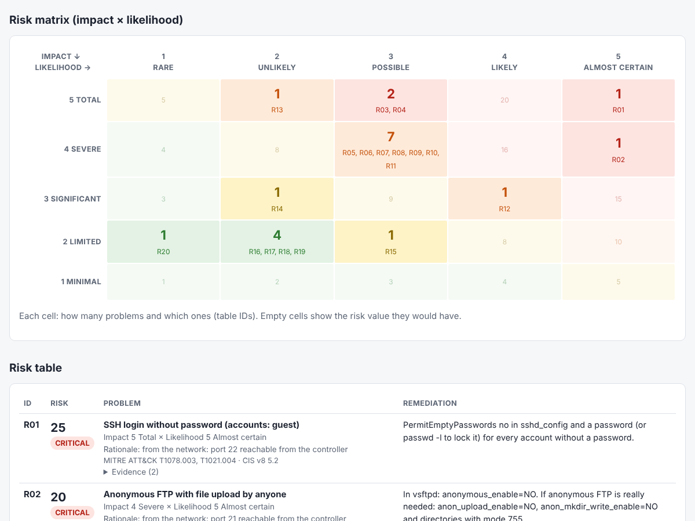
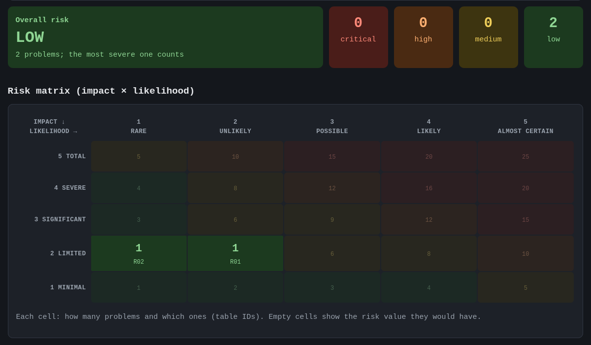
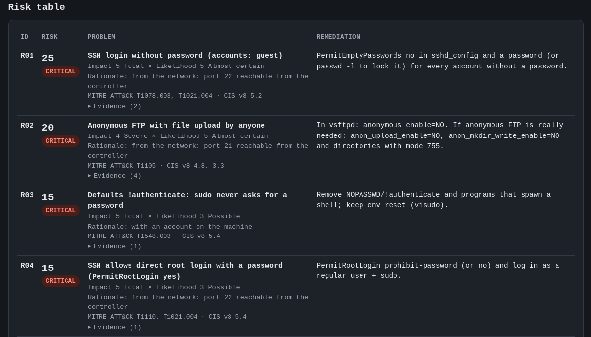

# ZeroStressRiskAssess

**Automated risk assessment of an Ubuntu Linux machine in a single command, producing a risk table computed as
`risk = impact × likelihood`.**

ZeroStressRiskAssess collects information about the machine from several sources (its own checks plus third-party
tools: nmap, ssh-audit, Lynis, Grype, Trivy, ClamAV, chkrootkit, rkhunter), merges findings that describe the same problem, assigns each problem a
justified **impact** (1–5) and **likelihood** (1–5), and writes a report (HTML to open in a browser, plus Markdown and
JSON) containing:

- the overall risk level of the machine;
- the **5×5 impact × likelihood matrix** with the problems placed in it;
- the **risk table**, sorted from the most severe: problem, impact, likelihood, rationale, remediation, evidence;
- the CVE list per package, separating those fixable right away from those without a fix;
- which checks were executed, skipped or failed (a skipped check must never look like a clean one).

The assessment can run **from outside** (from your machine, the *controller*, which first looks at the target from the
network and then logs in over SSH) or **from inside** (`--local`, on the machine itself).



*Real report from the Docker lab included in the repository (fake data and credentials). Full example:
[`ZeroStressRiskAssess/docs/sample-report.html`](ZeroStressRiskAssess/docs/sample-report.html) (download it and open it in a browser) and
[`ZeroStressRiskAssess/docs/sample-report.md`](ZeroStressRiskAssess/docs/sample-report.md).*

---

## Disclaimer

### ⚠️ Liability notice and terms of use (Red Teaming & Risk Assessment)

Use of this tool is permitted exclusively for legitimate risk assessment, adversary simulation (Red Teaming) and
information security verification activities, subject to prior written, explicit and formal authorisation from the
lawful owner of the target systems. Running network scans, asset enumeration, vulnerability assessments or any attack
simulation tactic against third-party IT infrastructure without a formal written agreement (Rules of Engagement) is
strictly prohibited. Such actions violate the law and are subject to civil and criminal prosecution.

### ⚖️ Quadri Normativi e Rischi Penali (Ordinamento Italiano)

Le attività di Red Teaming non autorizzate possono integrare gravi fattispecie di reato ai sensi del Codice Penale
italiano, tra cui:

- **Art. 615-ter c.p. (Accesso abusivo a un sistema informatico o telematico):** L'utilizzo di tool per forzare,
  eludere o testare le difese perimetrali senza autorizzazione configura il reato di accesso abusivo, anche in assenza
  di esfiltrazione di dati.
- **Art. 615-quater c.p. (Detenzione e diffusione abusiva di codici di accesso):** Applicabile qualora il tool venga
  utilizzato per raccogliere, testare o sfruttare credenziali non autorizzate.
- **Art. 635-bis e successivi c.p. (Danneggiamento informatico):** Le tecniche invasive di Red Teaming possono saturare
  la banda, mandare in crash servizi critici o corrompere registri di sistema. Il danno, anche se involontario, è
  punibile per legge.

### 🌍 International legal framework

Outside Italy the same conduct is a criminal offence almost everywhere. The instruments below are the ones with
international reach; they are a starting point, not legal advice: the law that applies depends on where the operator,
the target systems and the data are located, and several jurisdictions may apply at once.

**Council of Europe Convention on Cybercrime ("Budapest Convention", CETS No. 185, 2001)** — the main international
treaty on computer crime, open to non-European states as well (82 Parties as of July 2026, including Italy, which
ratified it with Law 48/2008, the United States, the United Kingdom, Japan, Canada and Australia). Parties must
criminalise:

- **Art. 2 – Illegal access**: access to the whole or any part of a computer system *without right*;
- **Art. 3 – Illegal interception**: interception of non-public transmissions of computer data;
- **Art. 4 – Data interference** and **Art. 5 – System interference**: damaging, deleting or altering data, or
  seriously hindering the functioning of a system (e.g. a scan or test that brings a service down);
- **Art. 6 – Misuse of devices**: producing, distributing, procuring or possessing tools, passwords or access codes
  *with intent* to commit the offences above. Art. 6(2) states explicitly that this does **not** apply when the tool
  is used for **authorised testing or protection** of a computer system: the difference between a security assessment
  and a crime is the authorisation, not the tool.

**United Nations Convention against Cybercrime (2024)** — adopted by the UN General Assembly in December 2024 and
opened for signature in Hanoi on 25 October 2025. Its criminalisation chapter mirrors the Budapest Convention
(Art. 7 illegal access, Art. 8 illegal interception, Art. 9–10 interference with data and systems, Art. 11 misuse of
devices). It enters into force 90 days after the 40th ratification; as of mid-2026 it had only a few ratifications and
was **not yet in force**. Civil society and industry groups have criticised it for not clearly protecting good-faith
security research, which is one more reason to keep written authorisation for every test.

**European Union – Directive 2013/40/EU on attacks against information systems** — binding on every EU Member State
(transposed into national criminal codes, e.g. the Italian articles above). It requires penalties for illegal access
(Art. 3), illegal system interference (Art. 4), illegal data interference (Art. 5), illegal interception (Art. 6) and
**tools used for committing offences** (Art. 7), i.e. producing, obtaining or distributing software designed or
adapted for those offences, *with the intention* of committing them. Its recitals clarify that tools created for
legitimate purposes, such as testing the reliability of products or the security of systems, are not targeted.
When an assessment touches personal data (accounts, logs, files found on the target), the **GDPR** (Regulation (EU)
2016/679) also applies: the report must be protected and kept only as long as needed.

**Examples of national laws** (non-exhaustive):

- **United Kingdom – Computer Misuse Act 1990**: s. 1 unauthorised access, s. 3 unauthorised acts impairing a computer,
  **s. 3A** making, supplying or obtaining articles for use in those offences;
- **Germany – Strafgesetzbuch (StGB)**: §202a data espionage, §202b interception, **§202c** preparing those offences
  (the so-called "hacker paragraph", which covers tools as well), §303a–303b data alteration and computer sabotage;
- **United States – Computer Fraud and Abuse Act (18 U.S.C. § 1030)**: accessing a protected computer without
  authorisation or exceeding authorised access; state laws add further offences. Since 2022 the Department of Justice
  policy is not to prosecute good-faith security research, but that policy does not bind courts, states or private
  parties suing for damages.

The rule is the same everywhere: **only test systems you own or are explicitly authorised in writing to test, within
the agreed scope and time window.**

### 🛡️ Mandatory requirements for the operator (Red Team standard)

Before launching any feature of this tool, the operator must verify that the following are in place:

- **Authorisation letter** (Authorization to Attack / "Get Out of Jail Free Card"): a document signed, digitally or in
  original, by the legal representative of the target organisation.
- **Detailed Rules of Engagement (RoE):** a technical agreement that clearly defines the scope (IP addresses, subnets,
  domains, accounts), the permitted methodologies, the operational limitations and the time window (days and hours)
  of the activity.
- **De-escalation channel:** a fast communication protocol with the target's Blue Team / SOC to stop all activities
  immediately in case of real incidents or critical false positives.

### ❌ Limitation of liability

The developers and distributors of this software accept no liability for direct or indirect damage, data loss,
service interruptions or legal consequences (civil or criminal) arising from improper, unauthorised or malicious use
of the tool. The end user is solely and exclusively responsible for the legal compliance of their actions.

The tool itself asks for confirmation of the authorisation before every assessment (`--yes` skips the question and
is intended only for automation in authorised contexts).

---

## Table of contents

- [Disclaimer](#disclaimer) (including the [international legal framework](#-international-legal-framework))

1. [How it works in brief](#1-how-it-works-in-brief)
2. [Requirements](#2-requirements)
3. [Installation](#3-installation)
4. [Full test with the Docker lab](#4-full-test-with-the-docker-lab)
5. [Use on a real machine](#5-use-on-a-real-machine)
6. [Parameters](#6-parameters)
7. [The risk model](#7-the-risk-model)
8. [What is checked and by which source](#8-what-is-checked-and-by-which-source)
9. [Output](#9-output)
10. [What is left on the target (nothing)](#10-what-is-left-on-the-target-nothing)
11. [CVE verification utilities](#11-cve-verification-utilities)
12. [Troubleshooting](#12-troubleshooting)
13. [Repository layout](#13-repository-layout)
14. [Future work](#14-future-work)
15. [References](#15-references)

---

## 1. How it works in brief

```
 controller (your machine)                             Ubuntu target
 ─────────────────────────                             ─────────────
 1. nmap + NSE scripts ───── from the network ──────▶  open ports, services, anonymous FTP...
 2. ssh-audit          ───── from the network ──────▶  weak SSH algorithms
 3. SSH connection (paramiko), root/sudo check ─────▶
 4. installs ClamAV + chkrootkit (apt) ─────────────▶  removed at the end
 5. internal checks ────────────────────────────────▶  accounts, sudo, sshd_config, permissions, services,
                                                         firewall, kernel, updates, MySQL, FTP...
 6. portable Lynis: copied to /tmp, executed, deleted; chkrootkit; rkhunter only if already installed
 7. package inventory ◀────────────────────────────── dpkg-query + apt list --upgradable
    → CycloneDX SBOM → Grype and/or Trivy (on the controller) → CVEs
 8. cleanup (always, even on errors or Ctrl-C)
 9. correlation → impact × likelihood → reports/<host>_<date>/report.html (+ .md, .json)
```

Why this order: the network checks run **before** logging in, so the machine is seen as an attacker sees it; the
likelihood of every network-related problem is then **adjusted according to what nmap actually observed** (a vulnerable
service on a port closed by the firewall is less likely to be exploited than an exposed one).

With `--local`, steps 1–2 and the SSH connection are skipped: the report states explicitly that network exposure
**was not verified**.

---

## 2. Requirements

### Controller (the machine you run ZeroStressRiskAssess from)

| What | Required? | Why | How to install it (Ubuntu/Debian) |
|---|---|---|---|
| Python ≥ 3.9 with `venv` | yes | the tool is written in Python | `sudo apt install python3 python3-venv` |
| git | yes | cloning the repository and Lynis | `sudo apt install git` |
| paramiko | yes | SSH connection | installed by `setup.sh` into `.venv` |
| Lynis | recommended | ~250 hardening checks | cloned by `setup.sh` into `vendor/lynis` |
| nmap | recommended | ports and services seen from the network, exposure | `sudo apt install nmap` |
| ssh-audit | recommended | SSH algorithms | `sudo apt install ssh-audit` (or `pipx install ssh-audit`) |
| Grype | recommended | CVEs of the installed packages; the only source of the KEV flag (actively exploited) | `curl -sSfL https://get.anchore.io/grype \| sudo sh -s -- -b /usr/local/bin` |
| Trivy | optional | second CVE source: with Grype the results are merged, alone it replaces Grype | Aqua's signed APT repository, see below |
| Docker + compose plugin | lab only | test machines | <https://docs.docker.com/engine/install/ubuntu/> |

The "recommended" tools are optional: if one is missing, the corresponding check is **skipped** and the report says
so in the *Checks performed* section. The risk is still computed from the available sources.

**Outbound connections required from the controller**: GitHub (Lynis clone); on their first run Grype downloads its
vulnerability database (~60–200 MB) from `grype.anchore.io` and Trivy from `mirror.gcr.io` / `ghcr.io`. Without network
access the CVE check fails and reports it.

**Installing Trivy safely.** In March 2026 Trivy was hit by a supply-chain attack: the **v0.69.4** release (binary
and container image) was published by attackers with stolen credentials and steals secrets from the machine that
runs it (CVE-2026-33634, in the CISA KEV catalogue). Install it from Aqua's **signed APT repository**, so that `apt`
verifies every package against the repository key, rather than with `curl | sh` scripts:

```bash
sudo apt-get install wget gnupg
wget -qO - https://aquasecurity.github.io/trivy-repo/deb/public.key | gpg --dearmor | sudo tee /usr/share/keyrings/trivy.gpg > /dev/null
echo "deb [signed-by=/usr/share/keyrings/trivy.gpg] https://aquasecurity.github.io/trivy-repo/deb generic main" | sudo tee -a /etc/apt/sources.list.d/trivy.list
sudo apt-get update && sudo apt-get install trivy
trivy --version            # must NOT be 0.69.4
```

ZeroStressRiskAssess refuses to run Trivy 0.69.4 even if it is installed, and `setup.sh` flags it. If that version
ever ran on your machine, treat the secrets reachable from it (SSH keys, tokens, passwords) as exposed and rotate them.

### Target (the machine being assessed)

| What | Why |
|---|---|
| **Ubuntu** (tested on 22.04 and 24.04) or Debian | the checks rely on `apt`/`dpkg`; other distributions are future work |
| **running SSH service** (remote mode only) | the tool logs in over SSH |
| a **root** user, or a user with **sudo** | many files read (shadow, sudoers, configurations) are root-only |
| `bash`, `tar`, `sha256sum`, `coreutils` | present on any Ubuntu; needed by portable Lynis |
| Internet access for `apt` (recommended) | to install ClamAV and chkrootkit and update the ClamAV signatures. Without it those checks are skipped and the report says so |
| ~500 MB free in `/var` and `/tmp` | ClamAV and its signatures, temporary Lynis copy |

Nothing has to be installed manually on the target: ZeroStressRiskAssess brings Lynis, installs ClamAV and chkrootkit
and removes everything at the end. rkhunter is used only if the target already has it (see section 10).

---

## 3. Installation

```bash
git clone <URL-of-this-repository> ZeroStressRiskAssess
cd ZeroStressRiskAssess
./setup.sh                 # creates .venv, installs ZeroStressRiskAssess, downloads Lynis, checks the tools
```

`setup.sh` **does not install anything system-wide** (it never uses sudo): for each missing program it prints the
command to run. Example output on a freshly installed machine:

```
External programs:
  [ok]      python3 3.12.3
  [missing] nmap            -> sudo apt install nmap
  [missing] ssh-audit       -> sudo apt install ssh-audit   (or: pipx install ssh-audit)
  [missing] grype (CVE)     -> curl -sSfL https://get.anchore.io/grype | sudo sh -s -- -b /usr/local/bin
  [missing] trivy (CVE, optional second source) -> see README, Requirements (Aqua's signed APT repository)
  [ok]      git
  [missing] docker (lab only) -> https://docs.docker.com/engine/install/ubuntu/
  [ok]      Lynis 3.1.8 in vendor/lynis
```

Install whatever is missing, then:

```bash
./setup.sh --check         # re-checks the external programs only
source .venv/bin/activate  # makes the `zsra` command available
zsra --version
```

The command is `zsra`. It must be run with the virtual environment active (`(.venv)` appears in the prompt), and
every new terminal starts with it inactive. Without activating `.venv`, `.venv/bin/zsra ...` or
`.venv/bin/python3 -m zerostressriskassess ...` also work (the Python package uses the long lowercase name, as
required by Python naming conventions).

For Docker, after installing it add your user to the `docker` group and log in again:
`sudo usermod -aG docker $USER`.

---

## 4. Full test with the Docker lab

To test the whole system **without any machine to assess at hand**, the repository includes a lab with **four Ubuntu
24.04 machines** (Docker containers), from the worst to the best. They show that the tool really tells a
compromisable machine apart from a well-configured one, rather than always reporting "everything red".

| Profile | IP | What kind of machine | Expected risk |
|---|---|---|---|
| `severe` | 172.28.10.10 | deliberately severe misconfigurations: accounts without password, passwordless sudo, root over SSH with password, anonymous FTP with upload, 777 permissions, outdated packages, EICAR files | **CRITICAL** |
| `medium` | 172.28.10.11 | updated server configured in a hurry: clear-text FTP without firewall, SSH with password, passwordless sudo rule, world-writable upload directory | **HIGH** |
| `clean` | 172.28.10.12 | freshly installed and updated Ubuntu Server, **no changes**: SSH password login and no firewall remain | **HIGH** |
| `secure` | 172.28.10.13 | hardened configuration: key-only SSH with modern algorithms, nftables firewall, sudo with password and logging, automatic updates, banner, password ageing | **LOW** (passes) |

`clean` shows that "freshly installed" does not mean "secure": Ubuntu's default settings leave SSH password login
enabled and reachable from the network. `secure` shows how to fix it: in `lab/profiles/secure.sh` each block maps to
one of the tool's checks.

```bash
./lab/lab.sh up               # builds and starts the four machines (first time: a few minutes)
./lab/lab.sh info             # what each profile contains and what to expect
./lab/lab.sh assess severe    # full assessment of one profile (≈ 3–6 minutes), report in reports/lab-severe/
./lab/lab.sh verify           # assesses ALL profiles and compares them with the expected risk
```

Actual result of `./lab/lab.sh verify --skip clamav` (2026-10-14):

```
Result (counts: C=critical H=high M=medium L=low):
  severe  expected CRITICAL  got CRITICAL 4C 9H 2M 5L     OK
  medium  expected HIGH      got HIGH 0C 5H 2M 5L         OK
  clean   expected HIGH      got HIGH 0C 1H 1M 3L         OK
  secure  expected LOW       got LOW 0C 0H 0M 2L          OK

4 of 4 profiles as expected. Reports in reports/lab-PROFILE/.
```



*The `secure` profile passes: only two low problems remain (Lynis suggestions and recently modified account files,
which is normal for a freshly created machine).*

Options after the profile are passed to the tool, also with `verify`: for example
`./lab/lab.sh verify --clamav-quick` or `./lab/lab.sh assess medium --skip clamav`.

`assess severe` is equivalent to:

```bash
.venv/bin/python3 -m zerostressriskassess 172.28.10.10 -u dev -i lab/.ssh/lab_key --accept-new-hostkey --yes \
    --out-dir reports/lab-severe
```

In the other profiles `dev` uses sudo **with a password** (as on a real server): `lab.sh` passes it to the tool with
`--sudo-pass-env`, i.e. through an environment variable of that single command rather than on the command line
(where any user could see it with `ps`).

Lab data (all **fake**, existing only inside the containers):

| | |
|---|---|
| network | `172.28.10.0/24` (configurable: `LAB_PREFIX=10.99.0 ./lab/lab.sh up` → IPs .10 .11 .12 .13) |
| ports published on the controller | SSH on `127.0.0.1:2222` (severe), `2223` (medium), `2224` (clean), `2225` (secure); severe's FTP on `127.0.0.1:2121` |
| assessment user | `dev`, with the key `lab/.ssh/lab_key` (generated by `lab.sh up`, ignored by git) |
| `dev` sudo password | severe: not needed (`!authenticate`); medium `dev2020`; clean `Clean-Lab-2026`; secure `Secure-Lab-2026-q7` |
| other weak credentials (severe) | `dev2/welcome1`, `root/Passw0rd`, `guest/` (empty) |

Other commands:

```bash
./lab/lab.sh status           # container status
./lab/lab.sh ssh secure       # log in as dev
./lab/lab.sh reset medium     # recreate one profile from scratch (no profile: all), like reverting a snapshot
./lab/lab.sh down             # stop and remove all containers
```

Notes:

- **Updates**: `up` re-runs the package upgrade of the `medium`, `clean` and `secure` profiles every time (about one
  extra minute each). If Ubuntu publishes a security update *after* `up`, `secure` is rated HIGH: this is the correct
  behaviour (a machine that is not up to date does not pass). Run `./lab/lab.sh up secure` again.
- **ClamAV** needs the containers to reach `database.clamav.net`; if the network blocks it, the check is reported as
  *error* and the rest of the assessment is unaffected.
- **Container ≠ real machine**: no systemd and no kernel of its own. The tool detects this and does not report items
  that, inside a container, belong to the host (kernel modules, boot, auditing, etc.).
- The `secure` firewall lives only inside its container (the `NET_ADMIN` capability is granted to that service only):
  the host is not affected.

---

## 5. Use on a real machine

`zsra` can be used in two ways, with exactly the same options:

- **everything in one command**: `zsra HOST -u USER [options]` (or `zsra --local`). This is the mode for scripts and
  automation;
- **interactive console**: `zsra` alone. It opens the ZeroStressRiskAssess console with the mascot, the `zsra >`
  prompt, built-in help and TAB completion: convenient when working by hand on several machines.

Console commands:

```
zsra > help                                    # list of commands (help COMMAND for details)
zsra > scan 192.168.1.50 -u admin -i ~/.ssh/id_ed25519          # assess a host over SSH
zsra > local --skip clamav                     # assess this machine (start zsra with sudo)
zsra > reports                                 # latest reports, newest first, with overall risk
zsra > open 1                                  # open HTML report number 1 in the browser
zsra > tools                                   # nmap, ssh-audit, grype, trivy, Lynis: what is present and what is missing
zsra > options                                 # all options accepted by scan/local
zsra > version                                 # tool version
zsra > clear                                   # clear the screen
zsra > exit                                    # exit (also quit or Ctrl-D)
```

The command history is stored in `~/.local/state/zsra/history` (mode 600: it contains target IPs and user names).
Passwords are never typed into commands: `--ask-pass` / `--ask-sudo-pass` prompt for them without echoing.

### The mascot

At startup (console or direct command) `zsra` shows the mascot, read from the text file
`zerostressriskassess/mascot.txt`. To change it:

- **for everyone**: replace the content of that file (any text: braille, classic ASCII art...);
- **for yourself only**, without touching the repository: `export ZSRA_MASCOT=~/my-mascot.txt`.

The mascot appears only on an interactive terminal: logs, pipes and scripts receive only useful output. To hide it:
`--no-banner` or `export ZSRA_NO_BANNER=1`; to disable colours, the standard `NO_COLOR=1` convention. For safety,
terminal control sequences are stripped from the file and at most 60 lines are shown.

### From outside (recommended)

```bash
# user with key and passwordless sudo
zsra 192.168.1.50 -u admin -i ~/.ssh/id_ed25519

# user with SSH password and sudo asking for a password
zsra 192.168.1.50 -u admin --ask-pass --ask-sudo-pass

# SSH on a different port, first contact (host key not yet in known_hosts)
zsra server.lan -p 2200 -u admin -i ~/.ssh/id_ed25519 --accept-new-hostkey
```

Passwords are requested on the terminal (never on the command line, where they would end up in the shell history
and in `ps`).

The target's host key is verified against `~/.ssh/known_hosts`. If the target is not there, ZeroStressRiskAssess stops:
connect once with `ssh` and verify the fingerprint, or use `--accept-new-hostkey` **only if you are sure you are
talking to the right machine** (trusted network, first contact).

### From inside

Copy the repository to the machine, run `./setup.sh`, then:

```bash
sudo .venv/bin/zsra --local
```

In this mode nmap and ssh-audit do not run (they would look at the machine from inside, i.e. without any firewall in
between): the likelihood of network problems is not adjusted for exposure, and the report says so. Grype and Trivy, if
installed, run on the machine itself.

### Speeding up or limiting the assessment

```bash
zsra HOST -u admin -i KEY --clamav-quick          # ClamAV only on the usual malware locations
zsra HOST -u admin -i KEY --skip clamav lynis     # without the two slowest checks (≈ 2–3 minutes)
zsra HOST -u admin -i KEY --skip chkrootkit       # without the rootkit check (≈ 1–2 minutes less)
zsra HOST -u admin -i KEY --nmap-ports -          # all 65535 ports (slower)
```

### Interrupted run

If the assessment is interrupted abruptly (lost connection, killed process), ClamAV and chkrootkit may have been left
installed:

```bash
zsra HOST -u admin -i KEY --recover
```

---

## 6. Parameters

| Parameter | Default | Meaning |
|---|---|---|
| `host` | — | IP or name of the target (omitted with `--local`) |
| `--local` | no | assess the machine running the command, without SSH |
| `-u, --user` | — (required with a host) | SSH user: root or with sudo |
| `-p, --port` | 22 | SSH port |
| `-i, --key` | agent / default keys | SSH private key |
| `--ask-pass` | no | prompt for the SSH password |
| `--ask-key-pass` | no | prompt for the key passphrase |
| `--ask-sudo-pass` | no | prompt for the sudo password |
| `--sudo-pass-env VAR` | — | read the sudo password from the environment variable `VAR` (automation) |
| `--accept-new-hostkey` | no | accept an unknown host key (first contact only) |
| `--lynis-dir` | `vendor/lynis` | Lynis copy to bring to the target |
| `--nmap-ports` | top 1000 | `1-1024,8080`; `-` = all |
| `--nse-tls` | no | also run `ssl-enum-ciphers` (TLS protocols/ciphers; more connections) |
| `--clamav-quick` / `--clamav-full` | critical directories | fast ClamAV scan / whole disk |
| `--skip` | — | checks to skip (list in `zsra --help`) |
| `--scan-timeout` | 60 | maximum minutes per check |
| `--out-dir` | `./reports` | report directory |
| `--keep-tools` | no | do not remove ClamAV and chkrootkit at the end (debugging only) |
| `--recover` | — | cleanup after an interrupted run |
| `--yes` | no | do not ask for the authorisation confirmation |
| `--no-banner` | no | do not show the mascot at startup (also `ZSRA_NO_BANNER=1`) |

Exit codes: `0` completed, `1` confirmation denied or `--recover` unsuccessful, `2` error (connection, permissions,
host key), `130` interrupted with Ctrl-C.

---

## 7. The risk model

### The two scales

**Impact** — what an attacker gains if the problem is exploited:

| | Level | Example |
|---|---|---|
| 5 | Total | full control of the machine (root) or of all its data |
| 4 | Severe | root reachable by a local user, credential theft, control of an important service |
| 3 | Significant | access to data or to a non-critical service |
| 2 | Limited | information useful for an attack, weakened defence |
| 1 | Minimal | best practice not followed, no direct damage |

**Likelihood** — how easily it can happen:

| | Level | Example |
|---|---|---|
| 5 | Almost certain | exploitable by anyone on the network, without credentials, with common tools; or already happening |
| 4 | Likely | from the network with little effort (guessable password, known technique) |
| 3 | Possible | requires any account on the machine |
| 2 | Unlikely | requires special conditions: interception, physical access, a second flaw |
| 1 | Rare | requires being an administrator already, or is theoretical |

**Risk = impact × likelihood** (1–25):

| Risk | Level |
|---|---|
| 15–25 | CRITICAL |
| 10–14 | HIGH |
| 5–9 | MEDIUM |
| 1–4 | LOW |

The overall risk of the machine is that of its worst problem (a single critical problem is enough to compromise
everything), shown together with the count per level.

### Where the numbers come from

1. **Correlation**: different findings describing the same problem become a single row, with the evidence from all
   sources (e.g. nmap sees anonymous FTP + the internal check reads `anonymous_enable=YES` + the permissions check
   finds world-writable FTP directories). The risk is therefore not counted twice.
2. **Rules**: `zerostressriskassess/risk.py` contains a rule table (`RULES`, `PORT_RULES`) mapping each problem type
   to impact, base likelihood, attack vector (network, local, interception, physical...) and **recommended
   remediation**. Every report row explains the rationale for both values.
3. **Measured exposure**: if a problem concerns a network service and nmap saw the port **closed or filtered**, the
   likelihood drops by 2 (the firewall reduces the risk, it does not remove it).
4. **CVEs**: likelihood 5 if the CVE is in the CISA **KEV** catalogue (actively exploited), 4 if the CVSS vector is
   network with high/critical severity, 3 otherwise. Only CVEs whose **update is already available on the target**
   count as "fix now" (version comparison performed as `dpkg` does). With both Grype and Trivy, the same CVE on the same
   package counts once, with the more severe of the two ratings; each CVE records which scanner found it, and the
   report shows how many were found by both, only by Grype and only by Trivy. The KEV flag comes from Grype only.
5. **Fallback**: a finding no rule recognises gets values from its severity (critical 5×4, high 4×3, medium 3×3,
   low 2×2) and is marked *(estimate)* in the report.

The values are a reasoned, repeatable estimate, not an absolute truth: the report always shows the evidence, so the
reader can challenge or correct a value. A formal analysis must also take into account asset value and business
context (see ISO/IEC 27005 and the OWASP Risk Rating Methodology in the references).

---

## 8. What is checked and by which source

| Area | Source | Example problems |
|---|---|---|
| Ports and services seen from the network | **nmap** `-sV` + "safe" NSE scripts | exposed services, anonymous FTP, DNS zone transfer, certificates |
| SSH algorithms | **ssh-audit** | weak key exchange / ciphers / MACs |
| General hardening | **Lynis** (portable) | ~250 tests, grouped warnings and suggestions |
| Known vulnerabilities | **Grype** and/or **Trivy** on the package SBOM | CVEs fixable now, pending, without a fix |
| Malware | **ClamAV** | infected files (including the EICAR test file) |
| Rootkits | **chkrootkit** (installed temporarily), **rkhunter** (only if already present) | tampered commands, known rootkit and backdoor signatures, hidden files, sniffers; every "INFECTED" is cross-checked with the package checksums (`dpkg -V`), so known false positives are rated low |
| Accounts | native | multiple UID 0, duplicate UIDs, empty passwords, shells on system accounts |
| sudo | native | NOPASSWD, `!authenticate`, rules on commands that spawn shells |
| SSH (configuration) | native | `PermitRootLogin`, `PermitEmptyPasswords`, password login, `MaxAuthTries` |
| Permissions | native | world-writable files/directories, readable private keys, unusual SUID files |
| Persistence | native | cron, systemd units, suspicious authorized keys |
| Integrity | native | modified package files (`dpkg -V`) |
| Services and listeners | native | services listening on all interfaces |
| Firewall | native + nmap | no firewall, unfiltered open ports |
| Kernel / platform | native | sysctl parameters, ASLR, modules |
| Updates | native (`apt`) | pending security updates |
| MySQL / MariaDB | native | users without password, public listening, TLS |
| FTP (vsftpd) | native | anonymous access, anonymous upload, no TLS |
| DNS (bind) | native + nmap | open recursion, AXFR |
| Containers | native | exposed Docker socket, privileged containers |

Where relevant, every problem in the report also carries **MITRE ATT&CK** and **CIS Controls v8** references.

---

## 9. Output

For each run: `reports/<host>_<YYYYMMDD-hhmmss>/`

| File | Intended for | Content |
|---|---|---|
| `report.html` | **reading** | coloured matrix, risk table with expandable evidence, CVEs, method, checks, appendix. A single file with no external resources or scripts: it opens offline and can be printed to PDF from the browser |
| `report.md` | archiving / versioning | the same content in Markdown (ASCII-only graphics); readable on GitHub or in an editor's preview |
| `report.json` | other tools | all data in structured form, including the raw output of the checks |
| `report.json.sha256` | report recipients | JSON fingerprint: `sha256sum -c report.json.sha256` shows whether it has been modified |

To open the report at the end of the run (the exact path is printed on the terminal):

```bash
xdg-open reports/<host>_<date>/report.html       # default browser
```

The Markdown is not meant to be read with `cat` or as plain text in an editor: the table has many columns and the
lines wrap. If you need the `.md`, use a viewer: in VS Code `Ctrl+Shift+V` (preview), or GitHub.

Files are created with mode `600` (your user only): they contain sensitive details about the machine. Passwords and
secrets found in the evidence are **masked** before the report is written. Text coming from the target is treated as
data, never as formatting (no injectable HTML or links). The `reports/` directory is excluded from git: **never
commit reports** of real machines (the examples in `docs/` come from the lab and contain fake data).

At the end, a summary with the overall risk and the first 10 rows of the table is printed on the terminal.



In the table each row states **why** it has that likelihood: for R01, "port 22 reachable from the controller" is what
nmap actually measured. Had the port been closed by the firewall, the likelihood
would have dropped by 2.

---

## 10. What is left on the target (nothing)

- **ClamAV** and **chkrootkit** are installed with `apt` only if they were not already present, and removed at the end
  (together with the dependencies installed for them). chkrootkit needs `strings`, from `binutils`: on normal systems it
  is already there and is left untouched; on minimal systems it is installed and removed with chkrootkit. A manifest in
  `/var/lib/zerostressriskassess` records what to remove, even after an interruption (`--recover`).
- **rkhunter** is never installed. Its file check compares the system with a baseline created earlier: a baseline
  created now, on a machine that may already be compromised, would certify tampered files as good. If the target
  already has rkhunter, it is used as it is, the date of its baseline is shown in the report, and `rkhunter --propupd`
  is never run.
- **Lynis** is not installed: it is copied as an in-memory archive, verified with SHA-256, extracted into a temporary
  root-owned directory (`/tmp/zerostressriskassess-lynis.XXXXXX`, mode 700), executed and deleted.
- **Grype** and **Trivy** run on the controller: only the package list is read from the target.
- No service is modified or restarted. System logs record the SSH connection and the sudo commands as usual (as they
  should).

---

## 11. CVE verification utilities

`tools/` contains two scripts to verify the CVE part (they require Grype and/or Trivy):

- `tools/verify_sbom.py` — checks that Grype (or Trivy, with `--trivy`) reads the SBOM generated by ZeroStressRiskAssess the same way it would
  read the machine itself (same CVEs found);
- `tools/compare_cve.py` — compares the results of two CVE scanners (e.g. Grype and Trivy) on the same target.

Run without arguments, they print their usage. Example with the lab running:

```bash
grype zerostressriskassess-lab-severe:24.04 -o json > grype-lab.json
.venv/bin/python3 tools/verify_sbom.py zerostressriskassess-lab-severe grype-lab.json

trivy image --scanners vuln --format json -o trivy-lab.json zerostressriskassess-lab-severe:24.04
.venv/bin/python3 tools/verify_sbom.py zerostressriskassess-lab-severe trivy-lab.json --trivy
```

The Trivy integration was written against Trivy's documented JSON and SBOM formats, but in the development
environment Trivy's database could not be downloaded: the second command above is the check to run once on a machine
with Internet access. "in common" should match "A"; missing CVEs point to a difference in how the SBOM is read.

---

## 12. Troubleshooting

| Message / symptom | Cause and solution |
|---|---|
| `zsh: command not found: zsra` | the virtual environment is not active: `source .venv/bin/activate` (or use `.venv/bin/zsra`) |
| `SSHException: Server '...' not found in known_hosts` | the target is not in `known_hosts`: run `ssh user@host` once and verify the fingerprint, or use `--accept-new-hostkey` |
| `Root privileges are required` | the user has no sudo, or sudo asks for a password: add `--ask-sudo-pass` |
| in the report: `nmap / ssh-audit / grype / trivy not installed` | install it on the **controller** (section 2) or ignore it: the check is skipped and declared |
| in the report: `Lynis not found on the controller` | `./setup.sh` or `git clone https://github.com/CISOfy/lynis vendor/lynis` |
| `ClamAV signatures not updated` | the target cannot reach `database.clamav.net`: ClamAV cannot work, and the report says so |
| `chkrootkit NOT run: programs missing on the target` | chkrootkit stopped because a program it needs is missing (usually `strings`): install `binutils` or let the tool install it (it does unless the package is unavailable) |
| `chkrootkit: hidden-directory check (chkdirs) not reliable on this file system` | normal on BTRFS and in containers (overlayfs): chkdirs counts directory links, which do not add up on those file systems. Not a finding |
| CVE: database error | Grype's and Trivy's first run must download their databases: the controller needs Internet access (`grype db update`, `trivy image --download-db-only`) |
| `Trivy 0.69.4 is the compromised release` | that version is malicious (CVE-2026-33634): remove it, rotate the secrets reachable from the machine, reinstall from the signed APT repository (section 2) |
| `./lab/lab.sh up`: `permission denied ... docker.sock` | your user is not in the `docker` group (section 3) |
| lab: network already in use | `LAB_PREFIX=10.99.0 ./lab/lab.sh up` |
| lab: `container name ... is already in use` after updating the repository | containers created with the old Italian profile names: `docker ps -a --filter name=zerostressriskassess-lab-` and remove them with `docker rm -f NAME` |
| assessment interrupted midway | `zsra HOST ... --recover` |

---

## 13. Repository layout

```
ZeroStressRiskAssess/
├── README.md                 this file
├── setup.sh                  controller preparation
├── pyproject.toml            Python package and `zsra` command
├── requirements.txt          Python dependencies (paramiko)
├── zerostressriskassess/
│   ├── cli.py                parameters and terminal summary
│   ├── console.py            interactive console (`zsra` without arguments)
│   ├── banner.py, mascot.txt   startup mascot (the .txt file can be replaced)
│   ├── orchestrator.py       order of the checks, guaranteed cleanup
│   ├── risk.py               ★ impact × likelihood model (rules, scales, exposure)
│   ├── correlate.py          merging findings into problems, MITRE/CIS
│   ├── report.py             Markdown/JSON report
│   ├── htmlreport.py         HTML report (the one to read)
│   ├── cve.py, vercmp.py     package inventory, SBOMs, Grype/Trivy, dpkg version comparison
│   ├── portable.py           portable Lynis
│   ├── toolmgr.py            ClamAV/chkrootkit installation and removal, rkhunter detection
│   ├── ssh_client.py         remote (SSH) and local execution
│   └── scanners/             one module per check
├── docs/                     sample report and screenshots (from the lab)
├── lab/                      Docker lab: 4 Ubuntu 24.04 machines (lab.sh, profiles/*.sh)
├── tools/                    CVE verification utilities
└── vendor/lynis/             Lynis (downloaded by setup.sh, not versioned)
```

To add a check: a module in `zerostressriskassess/scanners/` returning a `ScanResult`, its registration in
`scanners/__init__.py` and, if needed, a rule in `risk.py` with impact, likelihood and remediation.

---

## 14. Future work

Features already implemented in the previous project (`DeepSecurityScan`), to be reintegrated:

- **RHEL / Rocky / Alma** support (dnf, EPEL, SELinux);
- report **encryption and signing** (age) and secure delivery;
- **comparison between two runs** (what was fixed, what is new);
- **resource and disk** checks (space, inodes, disk health);
- `--no-install` option (nothing installed on the target: ClamAV and chkrootkit skipped).

New:

- assessment of **multiple machines** from an inventory, with a summary table;
- **configurable weights** (YAML file) to adapt impact and likelihood to the context: asset value, production vs
  test environments;
- direct **PDF** export of the report (today: print to PDF from the HTML);
- application-level checks (web servers, PHP, additional databases);
- use of **EPSS** (CVE exploitation probability) alongside KEV;
- localisation of the interface and reports into other languages (e.g. Italian).

---

## 15. References

Risk methodology
- ISO/IEC 27005 — Information security risk management: <https://www.iso.org/standard/80585.html>
- NIST SP 800-30 Rev. 1 — Guide for Conducting Risk Assessments: <https://csrc.nist.gov/pubs/sp/800/30/r1/final>
- OWASP Risk Rating Methodology: <https://owasp.org/www-community/OWASP_Risk_Rating_Methodology>
- CIS Controls v8: <https://www.cisecurity.org/controls/v8>
- MITRE ATT&CK (Enterprise, Linux): <https://attack.mitre.org/matrices/enterprise/linux/>
- CIS Ubuntu Linux Benchmarks: <https://www.cisecurity.org/benchmark/ubuntu_linux>

Vulnerabilities
- CISA Known Exploited Vulnerabilities: <https://www.cisa.gov/known-exploited-vulnerabilities-catalog>
- CVSS v3.1 specification: <https://www.first.org/cvss/v3.1/specification-document>
- EPSS: <https://www.first.org/epss/>
- Ubuntu Security Notices / CVE tracker: <https://ubuntu.com/security/cves>
- CycloneDX (SBOM format): <https://cyclonedx.org/>
- Package URL (purl): <https://github.com/package-url/purl-spec>

Tools
- Grype: <https://github.com/anchore/grype>
- Trivy: <https://github.com/aquasecurity/trivy> — installation: <https://trivy.dev/docs/dev/getting-started/installation/>
- CVE-2026-33634 (Trivy supply-chain compromise): <https://cve.circl.lu/cve/CVE-2026-33634>
- Lynis: <https://github.com/CISOfy/lynis> — documentation: <https://cisofy.com/documentation/lynis/>
- nmap: <https://nmap.org/book/man.html> — NSE scripts: <https://nmap.org/nsedoc/>
- ssh-audit: <https://github.com/jtesta/ssh-audit>
- ClamAV: <https://docs.clamav.net/>
- chkrootkit: <https://www.chkrootkit.org/>
- rkhunter: <https://rkhunter.sourceforge.net/>
- Paramiko: <https://docs.paramiko.org/>
- Docker Engine on Ubuntu: <https://docs.docker.com/engine/install/ubuntu/>

Legislation (Disclaimer)
- Codice Penale (Italy), artt. 615-ter, 615-quater, 635-bis ss.: <https://www.normattiva.it/>
- Council of Europe, Convention on Cybercrime (CETS No. 185): <https://www.coe.int/en/web/cybercrime/the-budapest-convention>
- Council of Europe, Budapest Convention: parties and benefits (July 2026): <https://rm.coe.int/cyber-buda-benefits-1-july-2026-en/48802c5c24>
- United Nations Convention against Cybercrime (UNODC): <https://www.unodc.org/unodc/cybercrime/convention/home.html>
- Directive 2013/40/EU on attacks against information systems: <https://eur-lex.europa.eu/eli/dir/2013/40/oj>
- Regulation (EU) 2016/679 (GDPR): <https://eur-lex.europa.eu/eli/reg/2016/679/oj>
- UK Computer Misuse Act 1990: <https://www.legislation.gov.uk/ukpga/1990/18/contents>
- Germany, Strafgesetzbuch §202a–202c: <https://www.gesetze-im-internet.de/stgb/__202c.html>
- US Computer Fraud and Abuse Act, 18 U.S.C. § 1030: <https://www.law.cornell.edu/uscode/text/18/1030>
- US DOJ policy on charging CFAA cases (2022): <https://www.justice.gov/opa/pr/department-justice-announces-new-policy-charging-cases-under-computer-fraud-and-abuse-act>
